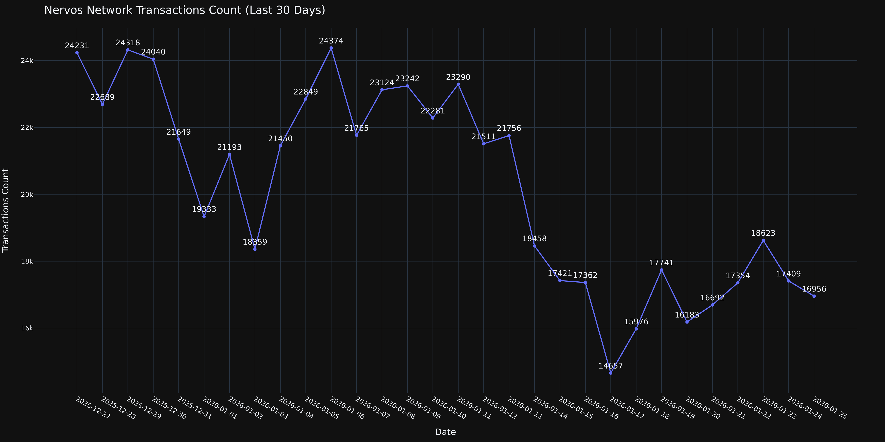

# CKB / Fiber Reports

CKB 日报、CKB 最近 30 天趋势图和 Fiber 最近 30 天趋势图，均可通过 Discord Webhook 推送。

## 目录结构

```text
reports/
  ckb/
    ckb_daily_report.py
    ckb_report_last_30_days.py
  fiber/
    fiber_report_last_30_days.py
```

其他独立工具（如 `txpool/`、`holiday_notify/`）保持原有位置。

## 环境要求

- Python 3.12（Ubuntu 24.04）
- 可访问 Explorer / Fiber API 和 Discord Webhook
- CKB 的 Prometheus 指标需能访问配置的 Prometheus API

```bash
sudo apt install python3.12-venv
python3.12 -m venv venv-report
source venv-report/bin/activate
pip install --upgrade pip
pip install -r requirements.txt
cp .env.example .env
```

请按需要编辑仓库根目录 `.env`，设置 `DISCORD_WEBHOOK_URL`、`PROMETHEUS_API_URL`、`FIBER_DISCORD_WEBHOOK_URL` 等变量。所提供版本的 CKB 脚本访问公共 Explorer API，无需 `X_API_KEY`。

## 运行

从**仓库根目录**运行（以确保 `python-dotenv` 读取根目录的 `.env`）：

```bash
source venv-report/bin/activate
python reports/ckb/ckb_daily_report.py
python reports/ckb/ckb_report_last_30_days.py
python reports/fiber/fiber_report_last_30_days.py
```

日报默认将 `ckb_daily_report.md` 保存到当前工作目录（从仓库根目录运行时就是仓库根目录）。其余报告生成趋势图并通过 Discord 发送。

**迁移提醒：** 使用旧路径的 crontab、systemd 服务或其他部署脚本需要更新为以上新路径。本次改动不会自动修改服务器上的定时任务。

## 图表示例


